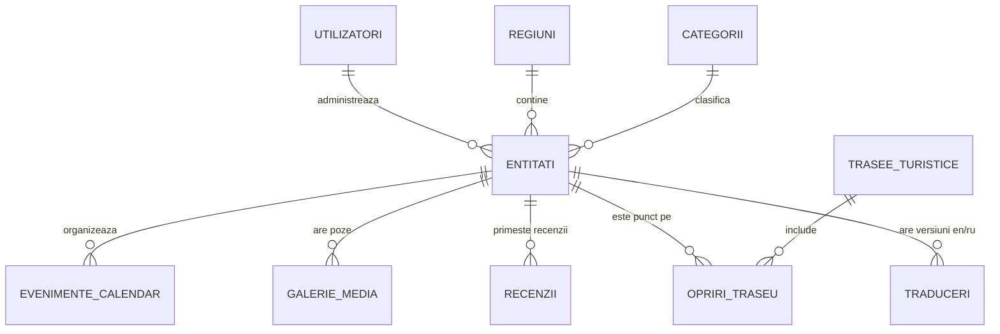

# Arhitectura Extensibilă a Platformei ClubTuristic.md

Acest document detaliază modul în care platforma a fost proiectată modular pentru a se extinde ușor de la baza de date actuală (999 entități) la un portal național complet cu aplicație mobilă, hărți GPS, plăți de bilete și conturi pentru primării.

---

## 1. Schema Bazei de Date Extinse (Relațională)

Baza de date [`clubturistic.db`](../clubturistic.db) conține deja cele 11 tabele pregătite pentru producție:



### Modulele deja pregătite:
1. **`entitati`**: Cei 999 de actori cheie (primării, consilii raionale, crame, festivaluri).
2. **`evenimente_calendar`**: Evenimente viitoare cu dată fixă, oră, preț bilet, meniu gastronomic și link de promovare.
3. **`utilizatori`**: Autentificare cu roluri ierarhice:
   - `superadmin`: Acces complet în Panoul Admin.
   - `primar_editor`: Acces limitat doar pentru a actualiza datele propriei primării și data hramului.
   - `organizator`: Acces pentru crame și organizatori de festivaluri (ex: Bostaniada, Castel Mimi).
   - `turist`: Poate salva evenimente favorite și lăsa recenzii.
4. **`trasee_turistice` & `opriri_traseu`**: Trasee tematice predefinite (ex: *Drumul Vinului*, *Traseul Plăcintelor din Codri*, *Comorile Găgăuziei*).
5. **`galerie_media`**: Fotografii de înaltă rezoluție pentru fiecare destinație.
6. **`recenzii`**: Note de la 1 la 5 stele și mâncăruri recomandate de vizitatori.
7. **`traduceri`**: Suport internațional (Română, Engleză, Rusă).

---

## 2. Direcții Cheie de Extindere Tehnică

### A. Migrarea de la SQLite la PostgreSQL / Supabase (1-Click)
- **În prezent**: SQLite local (`clubturistic.db`) este ultra-rapid și zero-cost.
- **Când site-ul are trafic mare**: Se poate migra cu o singură comandă pe **Supabase** (PostgreSQL în cloud cu tier gratuit generos), beneficiind de:
  - Autentificare securizată cu Google / Email integrată.
  - Storage pentru fotografii încărcate de utilizatori.
  - Bază de date distribuită geografic cu backup automat.

### B. Portalul Primăriilor ("Crowdsourced Events")
- Primăriile din Moldova nu mai trebuie căutate manual pe Facebook:
  - Se generează un link securizat unic pentru fiecare primărie: `clubturistic.md/primarie/actualizeaza?token=...`
  - Secretarul sau primarul primește un formular simplu pe telefon unde introduce:
    - Data exactă a Hramului din acest an;
    - Invitații speciali / artiștii;
    - Meniul tradițional pregătit de gospodinele satului.
  - Evenimentul apare automat pe hartă după aprobarea adminului!

### C. Harta Interactivă GPS (Leaflet / Mapbox)
- Fiecare localitate are cod CUATM care se mapează direct pe coordonate GPS.
- Turistul poate apăsa butonul **„În apropierea mea”** și vede pe hartă ce festival sau cramă este la mai puțin de 30 km distanță de el.

### D. PWA (Progressive Web App) & Notificări
- Site-ul web poate fi instalat pe ecranul telefonului (Android / iOS) fără descărcare din App Store / Google Play.
- Notificări automate: *„În acest weekend are loc Festivalul Mămăligii la Selemet! Vezi programul și meniul.”*

---

## 3. Containerizare Docker (Gata de Lansare pe Orice Server)

Platforma include suport Docker complet. Pentru a rula tot sistemul pe orice server Linux / VPS cu o singură comandă:

```bash
docker compose up -d
```
