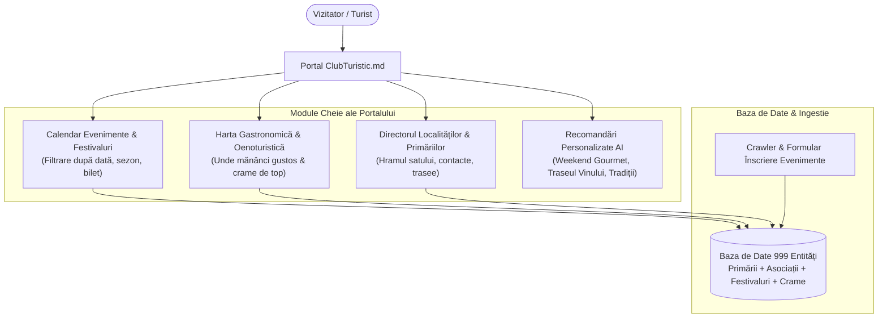

# Arhitectura Portalului "Club Turistic Moldova" (clubturistic.md)

Plan strategic de dezvoltare pentru portalul dedicat evenimentelor, festivalurilor etnoculturale și turismului gastronomic din Republica Moldova.

---

## 1. Viziunea și Obiectivele Produsului

**Misiune**: Oferirea unei platforme unificate și atractive unde orice vizitator (localnic sau turist străin) poate găsi:
1. **Ce să viziteze interesant în weekend**: Locuri pitorești, sate autentice, meșteri populari, rezervații, crame.
2. **Unde să mănânce gustos și deosebit**: Mâncăruri tradiționale la vatră, plăcinte, sarmale învârtite manual, mămăligă din ceaun, deserturi locale, preparate specifice fiecărei regiuni (ex: Lunca Prutului, Codrii Călărașilor, Găgăuzia).
3. **Calendarul interactiv al evenimentelor**: Toate festivalurile tematice (Bostaniada, Festivalul Mămăligii, Festivalul Prunei, Gustar, DescOperă, Hederlez, Zilele Vinului etc.) și Hramurile localităților.

---

## 2. Pilonii Funcționali ai Platformei

---

## 3. Modulele Cheie

### Modulul 1: Harta Interactivă Gastronomică ("Unde Mănânci Deosebit")
- Filtre specifice după preferințe culinare:
  - `Plăcinte & Bucate la Cuptor` (ex: Sadova, Clișova Nouă, Vorniceni, Butuceni, Asconi)
  - `Mămăligă & Friptură Tradițională` (ex: Selemet, Cimișlia, Văleni)
  - `Vin & Enoturism de Elită` (Castel Mimi, Cricova, Mileștii Mici, Château Vartely, Purcari, Et Cetera, Poiana)
  - `Bucătărie Etnică Găgăuză & Sudică` (Kara Gani, Comrat, Ceadîr-Lunga)
  - `Festivaluri Fructifere & Recoltă` (Prune Nisporeni, Mere Soroca, Căpșuni Sadova, Piersici Tudora, Bostan Bălăbănești)

### Modulul 2: Calendarul Național al Festivalurilor și Hramurilor
- Fiecare eveniment va avea:
  - Titlu, Dată, Locație exactă (link Google Maps)
  - Programul artistic și atracțiile principale
  - Meniul gastronomic disponibil
  - Detalii transport / cum se ajunge din Chișinău sau orașele mari
  - Contactul primăriei sau organizatorului pentru confirmare

### Modulul 3: Parteneriatul cu Primăriile (APL I & II)
- Portalul folosește baza de date cu cele **897 de primării** pentru:
  - Formular dedicat prin care primăriile își pot anunța gratuit evenimentele comunitare (Hramul satului, iarmaroace locale).
  - Promovarea producătorilor agricoli locali și a pensiunilor din fiecare comună.

---

## 4. Arhitectura Tehnică Recomandată

- **Frontend**: Next.js 14+ (React) sau Astro (pentru SEO excepțional și încărcare ultra-rapidă), integrat cu Tailwind CSS.
- **Hărți**: Leaflet.js / Mapbox cu geo-localizarea raioanelor din Moldova.
- **Backend / API**: FastAPI (Python) sau Node.js / Next Server Actions.
- **Stocare**:
  - PostgreSQL / Supabase sau SQLite pentru date tranzacționale și rezervări.
  - Sursa inițială: `baza_date_turism_evenimente_moldova.json` încărcat direct ca seed database.

---

## 5. Etapele Următoare de Implementare (Roadmap)

1. **Pasul 1 (Finalizat)**: Baza de date completă (999 entități cu primării, consilii, festivaluri, crame, contacte și clasificator CUATM).
2. **Pasul 2**: Crearea tabelului complementar `evenimente_sezoniere_moldova.json` cu datele calendaristice exacte pe lunile anului (Primăvară, Vară, Toamnă, Iarnă).
3. **Pasul 3**: Prototip UI (Pagină principală cu căutare, selector de raioane și filtru gastronomic "Ce vrei să guști azi?").
4. **Pasul 4**: Lansarea modulului de adăugare evenimente de către organizatori și primării.
